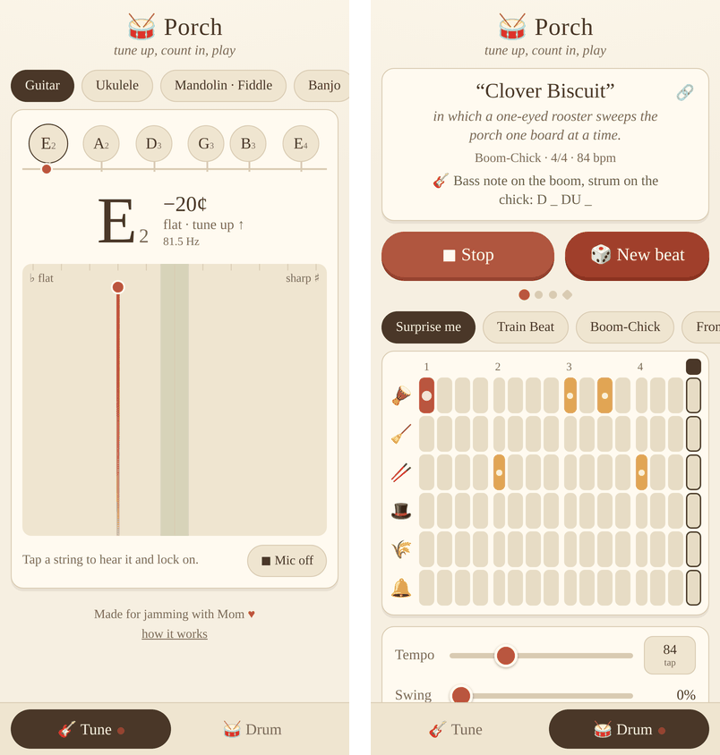

# 🥁 porch

**A tuner and a pocket drummer for porch jams, in one web page.** Tune up, tap Play, and a soft acoustic kit counts you in and keeps time. Every beat has a name and a one-line story, and there's always another one on the dice.



## Try it

**https://dglittle.github.io/porch/** on your phone (or a laptop). Nothing to install, and no account. Add it to your home screen if you like it.

Or run your own copy: it's one file. Open `index.html` over `https://` or `http://localhost` (browsers only give the microphone to those), for instance with `python3 -m http.server` in this folder.

## What it does

**Tune.** Pick an instrument (guitar, ukulele, mandolin or fiddle, banjo, bass, or "any note") and play a string.

- A big note name says what it hears, with how many cents flat or sharp and which way to turn.
- An ink line scrolls down the page showing the last four seconds of pitch, so you can watch a string settle into the green band as you turn the peg.
- Each string gets a ✓ once it has held in tune. When they all have one, a button offers to take you to the drums.
- Tap a string to hear it plucked and to lock the tuner onto it. That also works with no microphone at all, for tuning by ear.

**Drum.** Tap Play. You get a bar of sticks to count you in, then the beat.

- 🎲 **New beat** rolls a fresh one in the style you chose: Train Beat, Boom-Chick, Front-Porch Waltz, Back-Porch Shuffle, 6/8 Lullaby, Hambone or Porch Groove. Each has a strumming hint for the guitar player.
- Every beat gets a name and a story (*"Clover Biscuit", in which a one-eyed rooster sweeps the porch one board at a time*).
- Tap squares in the grid to change it: once for a hit, twice for an accent, drag to paint. Tap an instrument to hush it.
- Tempo (or tap it), swing, volume, a count-in you can turn off, and a little fill every fourth bar.
- 🔗 shares a link to the exact beat you're hearing, edits and all, to send to whoever you jam with.

The tuner and the drums take turns: starting one stops the other, because a microphone that can hear the drums can't hear your guitar.

## How it works

Everything is in [`index.html`](index.html): plain HTML, CSS and JavaScript, with no build step, no libraries and no network requests after the page loads. [`DESIGN.md`](DESIGN.md) says why it is the way it is.

- **The kit is made, not recorded.** Each drum is a few oscillators and some filtered noise through the Web Audio API, with a small generated room around them. The reference notes are plucked strings (Karplus-Strong) tuned to within a hundredth of a semitone.
- **Time comes from the audio clock.** A timer wakes up every 25 ms and books the notes for the next 120 ms on the audio clock, so a busy page can make the lights stutter but not the beat. When the page is in the background it books further ahead.
- **The tuner finds pitch itself.** It uses the McLeod pitch method (a normalised autocorrelation): a quick pass on a downsampled copy to find the right peak, then a fine pass at full rate, then a parabola through the top for the last fraction of a sample. It runs in under a millisecond. The microphone is asked for raw sound (no echo cancelling or noise suppression, which mangle musical notes), and nothing it hears leaves the page.
- **A beat is a seed.** The name, story and pattern all grow from one random number, and the whole beat (style, seed, tempo, swing, and the grid as you edited it) fits in the link after the `#`.
- **Phones first.** Audio starts on your first tap, as phones require; the screen stays awake while you play or tune; the microphone is let go the moment you leave the tuner.

## Tests

Node's built-ins only; nothing to install.

```
node test/pitch.test.js      # the pitch detector, against 600 notes whose pitch we know
node test/browser.test.js    # the real page in headless Chromium, with a pretend microphone
```

The browser test plays notes into a pretend microphone and checks that the tuner names them and gets the cents right, plays the drums and checks that no note was booked late and nothing clips, refuses the microphone and checks the page says what to do, and takes phone- and laptop-sized screenshots into `shots/`. It looks for Chromium at `/usr/bin/chromium`; set `CHROMIUM` to point it somewhere else.

## Not yet

- **Tested on real phones by ear.** The tests drive desktop Chromium. The code follows the iPhone rules (audio from a tap, the right audio session, resume after an interruption), but nobody has yet checked it against a real guitar on a real porch.
- **Other tunings.** Drop D, open G, a capo, or an A other than 440 Hz. "Any note" covers them for now.
- **Songs.** A beat is one bar plus fills. There are no verse and chorus patterns, and no way to keep a list of favourite beats other than saving their links.
- **Offline.** It needs a connection to load. After that it needs nothing, but it isn't an installable app with a service worker.
- **Tuning while the drums play.** They take turns.

## License

MIT
